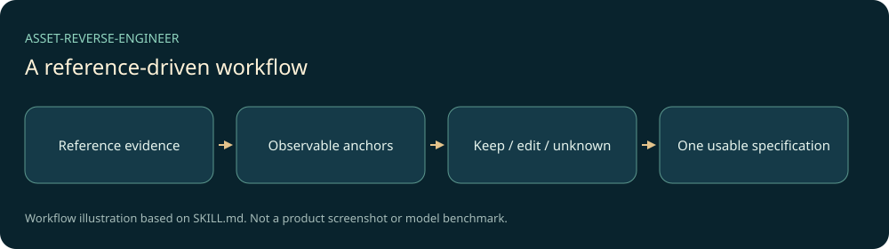

# AI 资产反推

把可访问的图片、视频、网页、文本、音乐或3D参考，整理为一份可以交给目标AI或开发Agent的复现指令。它先确认真正可观察的锚点，再区分必须保留、允许修改与无法恢复的部分。



## 功能与适用场景

- 六类模态参考，按当前资产加载必要文档。
- 忠实复刻、定向增强和局部编辑三种目标。
- 观察、推断与未知分开，不承诺找回原始提示词、种子或隐藏系统。
- 明确参考图、关键帧、多视图等非文本输入，适配目标平台时核对实际能力。

这是一套供AI Agent加载的指令与参考文档，**不是网页、独立模型或生成服务**。它不捆绑模型、账号、API密钥和用户资料。实际输出取决于所用宿主、模型、输入资产和工具权限。

## 安装与最简使用

准备一个支持`SKILL.md`的Agent宿主。以Codex个人技能目录为例，在已下载的本仓库目录打开PowerShell：

```powershell
$target = Join-Path $env:USERPROFILE ".codex/skills/asset-reverse-engineer"
if (Test-Path -LiteralPath $target) { throw "目标已存在，请先备份或另选目录" }
New-Item -ItemType Directory -Path $target | Out-Null
Copy-Item -Path SKILL.md, agents, references -Destination $target -Recurse
```

按宿主支持的方式刷新技能发现，随后使用明确指令：

```text
使用 $asset-reverse-engineer 分析我附上的自制海报。保留构图与信息层级，把主题色换成青绿色，给出一份图像生成指令。
```

也可以把上述三个入口复制到项目的`.agents/skills/asset-reverse-engineer/`，由宿主加载。已有目录需要先审阅差异；不把个人配置、凭据和用户输入放进技能包。其他宿主应按其技能发现约定放置文件。

## 技术与目录

运行依赖只有支持技能指令的AI宿主。Markdown是核心源码，`agents/openai.yaml`提供界面元数据，`references/`提供按需规则；没有Python、Node或浏览器运行时依赖。`README.md`、`PROVENANCE.md`、`LICENSE`和`docs/`属于公开交付说明。

```text
SKILL.md                技能入口、适用边界与流程
agents/openai.yaml       宿主展示信息
references/             按模态/任务加载的参考
docs/images/workflow.svg 源码流程示意图
```

## 验证与限制

本次在本机执行官方技能格式校验、全部本地Markdown引用检查，以及临时目录安装副本的逐文件哈希核对；发布前进行两轮敏感扫描。详见[VALIDATION.md](VALIDATION.md)。这些结果证明包格式和文件完整性，尚未形成跨模型行为基准，不能保证某个模型的生成效果。

## 开源与后续

本机定制项目的来源判断和版本对应见[PROVENANCE.md](PROVENANCE.md)。自有指令与文档按[MIT](LICENSE)公开；使用者仍应确认输入资产和目标模型服务的许可。本仓库不分发任何第三方模型、Skill全文或受保护参考作品。

后续优先补充经过授权的真实案例和多宿主行为评测；发现实际失败时再调整规则。更新见[CHANGELOG.md](CHANGELOG.md)。
